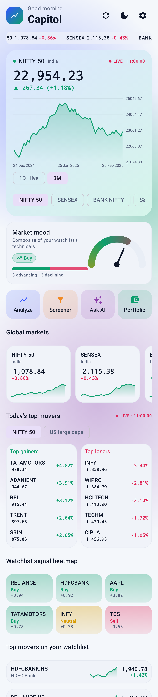
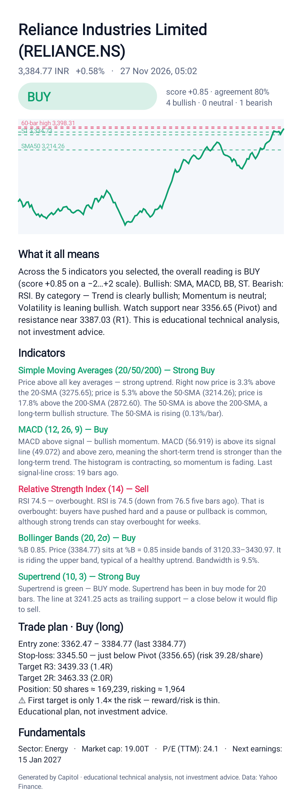

# Capitol

This is a financial tool developed to do technical analysis of any stocks listed in stock market.

Capitol is a native **Kotlin / Jetpack Compose** Android app. It pulls market data from Yahoo Finance, either on-device through the same endpoints [yfinance](https://github.com/ranaroussi/yfinance) uses or through a small bundled Python service that calls yfinance itself. It runs 21 technical indicators on any stock, index, ETF, currency or crypto, and explains each one in plain English.

| Home (dark) | Home (light) | Analysis (dark) | Analysis (light) |
|---|---|---|---|
|  |  |  |  |

*(Screenshots are rendered from synthetic data by `ScreenshotTest`.)*

## Features

- **Animated home page**: moving "aurora" background, a scrolling ticker tape, a hero index chart (NIFTY 50 / SENSEX / BANK NIFTY / S&P 500 / NASDAQ) with an animated reveal and drag-to-inspect crosshair, a *market mood* gauge with a spring-animated needle, an advance/decline breadth bar, global market cards with sparklines, a watchlist signal heatmap and top movers. Cards enter with staggered animations.
- **Technical analysis of any symbol** (`RELIANCE.NS`, `TCS.BO`, `^NSEI`, `AAPL`, `BTC-USD` …) over 1D to 5Y, on candlestick or line charts with indicator overlays and sub-panes.
- **Indicator filter with multi-select.** Pick any combination of 21 indicators in 6 categories, or use a preset (Swing trader, Trend, Momentum, Volume, Everything). For each selected indicator Capitol shows:
  - a signal (Strong Buy to Strong Sell) and the current metrics
  - **"What it says now"**: an interpretation written from the live values, e.g. "RSI is 72.4 (up from 65.1)… overbought…"
  - an explainer covering what the indicator measures and how to read it
  - a combined verdict, an agreement score, category scores, key support/resistance levels, and a summary that explains how *your selected* indicators agree or conflict
- **Indicators:** SMA 20/50/200 (golden/death cross), EMA 12/26, MACD, RSI (with divergence detection), Stochastic, Bollinger Bands (squeeze detection), ATR (stop suggestions), ADX/DMI, OBV, VWAP, CCI, Williams %R, MFI, Ichimoku Cloud, Parabolic SAR, ROC, Supertrend, Classic Pivots, Fibonacci retracement, Volume analysis, Candlestick patterns.
- **Watchlist**: add from search, swipe to delete, sort by signal, per-symbol price alerts.
- **AI Agent (Claude)**: a chat agent that runs Capitol's own tools on-device. Its tools are symbol search, technical analysis with any indicator set, price summaries, watchlist scan/add/remove, and portfolio read. Ask things like *"Scan my watchlist and rank the strongest setups"* or *"Analyse INFY with RSI, MACD and Supertrend"*.
- **Autopilot**: a background WorkManager job that re-analyses the watchlist every N hours and notifies you when a verdict changes or a price alert fires. If an API key is set, Claude summarises the changes.
- **Broker connections (read-only, for analysis)**:
  - **Zerodha Kite Connect v3**: in-app login, holdings, positions and margins.
  - **INDmoney** through the INDstocks API (access token), plus a **CSV import** fallback for any broker.
  - Holdings map to Yahoo symbols (`NSE → .NS`, `BSE → .BO`), so you can open any holding in the analyser or ask the agent to review the whole portfolio.
- **In-app updates**:
  - Installed from Google Play: the Play Core *flexible* in-app update flow.
  - Sideloaded: Capitol checks this repo's latest **GitHub Release**, downloads the APK inside the app with a progress bar, and opens the system installer.
- **Backtesting**: see how your chosen indicator set's verdict performed on a stock over 2 years: hit rate and average move 5/10/20/60 days later, compared with random days.
- **Timeframe confirmation**: daily and weekly verdicts side by side, flagged as aligned or conflicting.
- **Adjustable indicator settings**: RSI period and levels, MACD, SMA/EMA lengths, Bollinger, Supertrend and more (*Settings → Indicator settings*).
- **Compare**: up to 4 stocks side by side, with rebased performance and an indicator-by-indicator signal table.
- **Fundamentals and news**: P/E, market cap, 52-week range, ROE and more, plus recent headlines. The AI agent can use these too.
- **Indicator alerts and multiple watchlists**: alerts such as "RSI below 30", "Supertrend turns green" or "MACD bullish cross", sent once when the condition becomes true. Keep separate watchlists (e.g. India, US, Swing).
- **Home-screen widget** with your active watchlist's prices and verdicts.
- **Agent upgrades**: streaming replies, saved chats, estimated cost per answer, prompt caching, and automatic condensing of long chats.
- **Reliability**: automatic retry with back-off, an offline copy of the last good data, pull-to-refresh, auto-refresh during market hours, and *Settings → Diagnostics* to copy an error log for bug reports.
- **Screener**: scan NIFTY 50, Bank NIFTY, US large caps or your watchlists for setups such as a fresh Supertrend buy, an oversold bounce, momentum leaders or a Bollinger squeeze. Combine conditions, and optionally show only setups that triggered in the last 5 days.
- **Trade planner**: entry zone, stop-loss (ATR-based or just beyond the nearest support or resistance), targets at the next levels with reward/risk multiples, and position size from your capital and risk %.
- **Portfolio analytics**: allocation donut, sector mix, concentration and diversification score, value-weighted technical health, a 1-year value chart and risk warnings.
- **Earnings and dividend calendar** for all your watchlists, with an Autopilot reminder the day before results.
- **Share or export** an analysis as an image, PDF or text.
- **App lock** with fingerprint, face or screen lock (*Settings → Security*).

- **Live market updates**: prices stream from Yahoo Finance's live feed (the same one yfinance's `WebSocket` uses). Live updates change prices and day changes only (home hero price, index cards, ticker, movers and the Analyze price header), and prices flash green or red on each tick. Charts aren't redrawn by ticks; they offer 1D, 5D, 1W, 1M, 3M, 6M, 1Y, 3Y and 5Y views and a LIVE / DELAYED / MARKET CLOSED badge. If the stream is unavailable, Capitol falls back to refreshing quotes every 15 seconds. Live updates pause when the screen isn't visible.
- **Today's top movers**: the top 5 gainers and losers of the day in NIFTY 50 or US large caps, updating live.
- **Dark and light mode**: System / Light / Dark setting, a quick toggle on the home page, and optional Material You colours on Android 12+.

## Project layout

```
app/src/main/java/com/capitol/app/
├── analysis/      Indicator math (Indicators.kt), TechnicalAnalyzer, models & explanations
├── data/market/   Yahoo Finance (yfinance endpoints) + yfinance-service data sources, repository
├── data/broker/   Kite Connect + INDmoney clients, CSV import, portfolio repository
├── data/prefs/    DataStore settings, encrypted secret store
├── data/watchlist Watchlist persistence
├── agent/         Claude agent (tool-use loop), tool definitions, autopilot worker
├── update/        Play in-app updates + GitHub Releases self-updater
└── ui/            Compose screens: home, analysis, watchlist, agent, portfolio, settings, charts
backend/           FastAPI wrapper around yfinance (optional)
```

## Building

Requirements: JDK 17+ and the Android SDK (platform 36).

```bash
./gradlew assembleDebug             # app/build/outputs/apk/debug/app-debug.apk
./gradlew testDebugUnitTest         # indicator, analyzer, parser and screenshot tests
./gradlew testDebugUnitTest -Pscreenshots   # regenerate app/screenshots/*.png
```

## Configuration

### Market data
*Settings → Market data*
- **Direct (default)**: on-device calls to Yahoo's `/v8/finance/chart` and `/v1/finance/search`, the endpoints yfinance uses. No server needed.
- **yfinance service**: run the Python service and enter its URL. `10.0.2.2` reaches your computer from the Android emulator.
  ```bash
  cd backend && pip install -r requirements.txt && uvicorn app:app --host 0.0.0.0 --port 8000
  # or: docker build -t capitol-yf backend && docker run -p 8000:8000 capitol-yf
  ```
  Endpoints: `/history?symbol=&period=&interval=`, `/search?q=`, `/info?symbol=`, `/health`.

### AI agent
*Settings → AI Agent*: paste an Anthropic API key from <https://console.anthropic.com>. The key is stored encrypted with the Android Keystore and is only sent to `api.anthropic.com`. The agent uses the official `anthropic-java` SDK with model `claude-opus-5-5` and the server-side refusal fallback.

### Zerodha Kite
1. Create an app at <https://developers.kite.trade>. Set the redirect URL to `capitol://kite-callback`. Capitol reads the `request_token` from the in-app login page, so any redirect URL works.
2. In *Portfolio → Zerodha Kite*, enter the API key and secret, then tap **Log in with Kite**.
3. Kite access tokens expire every morning (about 6 AM IST); log in again when asked.

> The token exchange needs your Kite **API secret**. Capitol keeps it encrypted on the device. If you'd rather keep the secret off the phone, run the exchange on your own server.

### Zerodha via Kite MCP (stocks + Coin mutual funds, no API key)
*Portfolio → Zerodha via Kite MCP → Connect*. This logs in to Kite through Zerodha's official hosted MCP server (`https://mcp.kite.trade/mcp`). It needs no Kite developer app or API key. Capitol then reads your stock holdings and **Coin mutual funds**, shows them in the Portfolio tab and analytics, and lets the AI agent use Kite's read-only tools. Capitol finds the holdings tools in the server's own tool list, including mode-based tools such as `portfolio` / `mutual_funds` with `mode: "holdings"`, so it keeps working if Zerodha renames or merges them. Read modes only: modes such as place, modify or cancel are removed and refused. It never exposes order, login or other write tools. Kite logins last a day; reconnect when asked. If you use the Kite Connect API instead, mutual funds come from its `/mf/holdings` endpoint.

### INDmoney
**Recommended: INDmoney MCP (includes US stocks).** In *Portfolio → INDmoney (MCP)* tap **Connect with INDmoney** and sign in on INDmoney's own page. Capitol connects to INDmoney's official MCP server (`https://mcp.indmoney.com/mcp`) using standard MCP OAuth: discovery, dynamic client registration and PKCE. The AI agent can then read your INDmoney portfolio, Indian and US stocks, through the server's tools. Tokens are stored encrypted on the phone, refreshed automatically, and sent only to INDmoney, never to Claude.

**Alternative: INDstocks API token.**
Generate a token at indstocks.com → API → *Generate Token* and paste it in *Portfolio → INDmoney*. Tokens are short-lived. If you set a static IP for the token, requests must come from that IP. Without API access, export your holdings and use **Import holdings CSV**.

### Releases and in-app updates
GitHub Actions (`.github/workflows/android.yml`) runs tests on every push and PR. Pushing a tag like `v1.1.0` builds a release APK (versionName from the tag, versionCode from the run number) and publishes it as a GitHub Release. Installed apps find it through the in-app updater.

For updates to install over an existing app, every release must be signed with the **same key**. Add these repository secrets: `CAPITOL_KEYSTORE_BASE64` (`base64 -w0 release.jks`), `CAPITOL_KEYSTORE_PASSWORD`, `CAPITOL_KEY_ALIAS`, `CAPITOL_KEY_PASSWORD`. Without them, CI falls back to a debug key.

## Disclaimer
Capitol provides educational technical analysis based on historical price data. It is **not investment advice**. Data may be delayed or inaccurate, and Yahoo Finance data is intended for personal use. Capitol never places orders.
